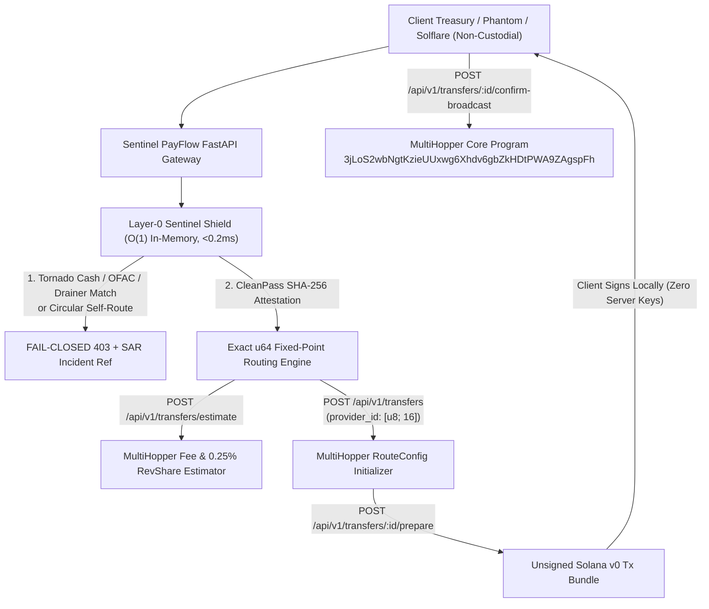

# 🛡️ Sentinel PayFlow — Institutional AML Pre-Flight & Programmable Settlement Engine on MultiHopper

[](https://opensource.org/licenses/MIT)
[](https://multihopper.com)
[)-10b981.svg)](#dual-layer-institutional-compliance-architecture)
[-brightgreen.svg)](tests/test_sentinel_payflow.py)
[](#non-custodial-security-guarantees)

> **Built for the MultiHopper Build & Route Challenge on Superteam Earn.**  
> **Sentinel PayFlow** transforms MultiHopper's non-commingled programmable Solana routing into an institutional B2B settlement rail for **Confidential Web3 Payroll**, **RWA Agricultural Export Forward Contracts**, and **Corporate Multi-Vendor Treasury Batches** — protected by a sub-millisecond (`<0.2 ms`) **Tornado Cash, OFAC SDN & Anti-Wash Pre-Flight Shield**.

---

## 🎯 The Real-World Problem We Solve

Enterprises, export cooperatives, and Web3 teams moving real USDC volume on Solana face a structural dilemma:
1. **Public Ledger Exposure Breaks Commercial Confidentiality:** Standard SPL transfers expose every employee's salary, every supplier's wholesale margin, and corporate treasury timing to competitors and wallet-drainer bots on public block explorers.
2. **Legacy Mixers (e.g., Tornado Cash) Are Toxic for Institutions:** Commingled liquidity pools expose clean corporate treasuries to illicit fund contamination and regulatory blocklists.
3. **Cross-Chain Taint & Wash-Volume Risks:** Funds bridged from EVM chains can carry Tornado Cash or Lazarus Group taint, while naive routing integrations suffer from floating-point rounding drift or circular wash transactions.

### How Sentinel PayFlow + MultiHopper Solves It
- **Non-Commingled Observational Privacy (MultiHopper Core):** Uses MultiHopper's isolated Token-2022 wrapper routing (`3–10` configurable API hops; up to `64` on-chain hops) and `destinations` Multisend (`up to 20 recipients`) so salaries and B2B margins remain private **without ever commingling assets**.
- **Layer-0 Tornado Cash & OFAC Pre-Flight Shield (`<0.2 ms`):** Before a route ever reaches MultiHopper's API (and MultiHopper's native TRM Labs screening), Sentinel PayFlow performs deterministic `O(1)` screening across **175 cryptographically verified entities** (**155 Tornado Cash pools/routers/OFAC SDN EVM addresses** for cross-chain bridge origins + **20 Solana OFAC/Exploiter/Drainer clusters**) and issues a **`CleanPass` SHA-256 Attestation**.
- **Strict Genuine-Usage & Anti-Farming Enforcement:** Automatically rejects circular self-routing (`sourceOwner in destinations`), duplicate Sybil splits, dust farming, and EVM/Base58 key mismatches.
- **Exact `u64` Conservation Invariant:** Uses fixed-point `Decimal` integer basis-point math (`split_raw_by_bps`) with deterministic remainder assignment, guaranteeing `sum(destinations[i].amountRaw) == amountRaw` down to a single micro-USDC (`10^-6`).

---

## 🏗️ Architecture & MultiHopper Integration



### MultiHopper Protocol Alignment
| MultiHopper Component | Sentinel PayFlow Implementation |
| :--- | :--- |
| **Core Program ID** | `3jLoS2wbNgtKzieUUxwg6Xhdv6gbZkHDtPWA9ZAgspFh` |
| **Integrator `provider_id`** | Exact 16-byte `[u8; 16]` (`SENTINELPAYFLOW1` / `0x53454e54494e454c504159464c4f5731`) linked to `[b"fee_schedule", provider_id]` PDA for **0.25% lifetime revenue share** (`$2,500` per `$1M` routed) |
| **External `reference_id`** | Deterministic 16-byte `[u8; 16]` SHA-256 slice (`derive_reference_id_bytes`) |
| **REST v1 Lifecycle** | Full client in [`multihopper_client.py`](sentinel_payflow/multihopper_client.py): `/transfers/estimate`, `/transfers`, `/transfers/{id}/prepare`, `/transfers/{id}/confirm-broadcast`, `/transfers/{id}` |
| **Environments** | Devnet (`https://devnet.multihopper.com/api/v1` via `mh_test_...`) & Mainnet (`https://multihopper.com/api/v1` via `mh_live_...`) |

---

## 💼 High-Volume B2B Verticals Built In

Designed to generate recurring, verifiable institutional volume well above the **$100,000 qualifying mainnet volume gate**:

1. **RWA Specialty Coffee & Agricultural Export Settlement (`create_b2b_commodity_route`)**
   - Splits container settlements (e.g., `$65,000 USDC` per lot) atomically across **90% Producer Cooperative**, **8% Wet Mill & Port Logistics**, and **2% Structuring Fee** across `6` isolated hops so buyers/exporters protect forward pricing.
2. **Confidential Enterprise & DAO Payroll (`create_payroll_route`)**
   - Multisend payroll batches (`up to 19 contractors + gateway fee = 20 destinations`) across `5` hops so team members receive clean USDC without exposing individual compensation tiers on public explorers.
3. **US CPA & Corporate Multi-Vendor AP Batch (`create_cpa_vendor_batch_route`)**
   - Settles multi-vendor invoices in a single batch and emits a cryptographic `CleanPass` SHA-256 receipt compatible with automated overnight ledger reconciliation (*Sentinel Nocturno / The Night Shift*).
4. **Marketplace & Last-Mile Delivery Split (`create_merchant_split_route`)**
   - Atomic `85% Merchant / 10% Courier / 5% Platform` checkout split.

---

## ⚡ 60-Second Quickstart (Judges & Reviewers)

### Option A: Local Python (Zero External Dependencies Beyond FastAPI/HTTPX)
```bash
pip install -r requirements.txt

# 1. Run the 21-test institutional verification suite
python tests/test_sentinel_payflow.py

# 2. Launch the Interactive Judge Console & API
uvicorn sentinel_payflow.api:app --host 0.0.0.0 --port 8080
```
Open **[http://localhost:8080](http://localhost:8080)** for the interactive console, or **[http://localhost:8080/docs](http://localhost:8080/docs)** for Swagger OpenAPI docs.

### Option B: Docker Compose (1 Command)
```bash
cp .env.example .env
# Optional: set MULTIHOPPER_API_KEY=mh_test_... or mh_live_... in .env
docker compose up --build
```

---

## 🧪 Live CLI Verification Commands

```bash
# 1. Health & O(1) Sanctions DB Probe (175 Tornado Cash / OFAC / Solana Exploiter Entities)
curl -s http://localhost:8080/health

# 2. Execute $65,000 USDC Specialty Coffee Export MultiHopper Route (Approved + Unsigned Bundle)
curl -s -X POST http://localhost:8080/api/v1/routes/preset/agro_coffee_export

# 3. Verify Fail-Closed Block on Tornado Cash Proxy V2 Cross-Chain Taint (HTTP 403)
curl -i -X POST http://localhost:8080/api/v1/routes/preset/attack_tornado_bridge

# 4. Verify Fail-Closed Block on Circular Wash-Volume Self-Routing (HTTP 403)
curl -i -X POST http://localhost:8080/api/v1/routes/preset/attack_circular_wash
```

---

## 🔒 Non-Custodial Security & Legal Notice

- **Zero Custody (`$0.00` Balance / Zero Private Keys):** Sentinel PayFlow never stores, accepts, or handles private keys or seed phrases. All `/prepare` endpoints return unsigned transaction payloads for client-side signing via Phantom, Solflare, Ledger, or Squads Multisig.
- **Compliance Disclaimer:** Sentinel PayFlow operates as a deterministic algorithmic pre-flight triage and programmable routing interface. Screening outputs reflect point-in-time sanctions matching and public heuristics and do not constitute legal advice or regulatory immunity.

---
**Engineered by [Sentinel Fleet Technologies](https://sentinelfleet.tech)** • Founder: Luis Aguilar (`@lamaaguilar9-web`)
